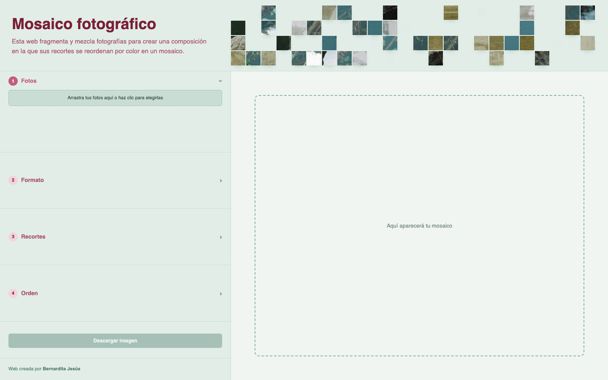

# Mosaico fotográfico

Esta web fragmenta y mezcla fotografías para crear una composición en la que sus recortes se reordenan por color en un mosaico.

Bernardita Jesús

## Cómo usarla

Se sigue por pasos en el panel de la izquierda, y el mosaico aparece en el recuadro de la derecha.

| Paso | Qué hace |
|---|---|
| **Fotos** | Se suben las fotos que se van a fragmentar |
| **Formato** | Tamaño final para Instagram: 9:16 · 1:1 · 4:5 · 3:4 · 1.91:1 |
| **Recortes** | Ancho y alto de los recortes, fijos o variados |
| **Orden** | Brillo · Tono · Saturación · Tono + brillo · Ajedrez (intercala las fotos sin mover los recortes) |

Se puede tocar un cuadrado del mosaico y luego otro para intercambiarlos, y descargar el resultado como imagen.
